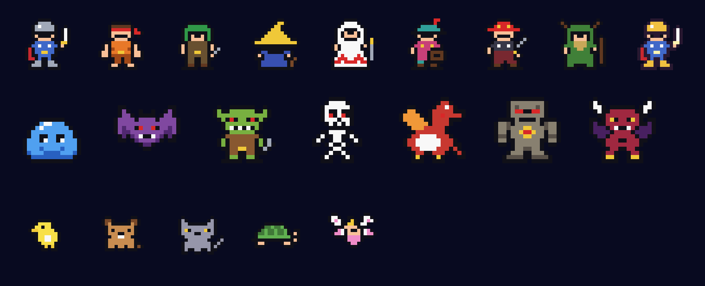

<!-- TODO: The main image is drawn from the app's own sprite and colour data, not taken from the running app. Swap it for a real phone screenshot of the Battle or Quests screen by saving one as .gitblog/screenshot.png. -->

## What it is

ToDo RPG is an Android app that turns your to-do lists into a pixel-art RPG. Each list belongs to a hero in your party:

| List | Hero | Class |
| --- | --- | --- |
| Work | Arthur | Knight: steady, strong hits |
| Health | Bo | Monk: a fast flurry of blows |
| Home | Wren | Ranger: high critical chance |
| Learning | Vivi | Mage: big magic damage |
| Social | Rosa | Cleric: weak hits, heals allies |

Finishing a task gives that hero EXP and a turn in battle. Spend those turns on the Battle screen to fight floor after floor of monsters, with a boss every fifth floor. You can rename the heroes and lists, and recruit up to eight heroes, adding a Bard, a Samurai and a Druid.

## Why I built it

<!-- TODO: Write this in your own words. What made you want to gamify your to-do list, and has it actually helped you get things done? -->

## Habits as game mechanics

The main design idea is that the game should reward real habits and gently punish skipped ones:

- **Daily quests** repeat every day and pay out gold. Doing them on consecutive days builds a streak, worth more EXP plus a 25-gold bonus every seven days.
- **One-off quests** pay 2.5 times a daily's EXP, and Hard ones give two battle turns.
- **Missed dailies hurt.** When a new day starts, the monster attacks the hero of each daily you skipped yesterday. A hero at 0 HP is knocked out until they level up or are revived. The penalty never covers more than three days, so coming back from a holiday doesn't wipe your party out.
- **The weekly raid** appears every Monday, sealed in chains. Each hero has to finish three of their quests that week to break their seal, so you can't ignore one area of your life and still win.

The battles have real depth too. Each hero's attack has an element, every monster has two hidden weaknesses, and hitting one reveals it and fills a **BREAK** gauge that stuns the monster for three turns. Monsters show their next move in advance, so Guard is a real choice. Behind that sits a whole RPG layer: gear in four rarities, a skill tree for each hero, promotion to an advanced class at level 15, pets that hatch from eggs after ten quests, 24 achievements and a bestiary.

## A game engine you can test

All the rules live in one pure Kotlin `GameEngine`, with no Android code in it. Every action, such as completing a quest, attacking, or rolling over to a new day, is a function that takes the current game state and returns a new one. The balance numbers sit in one `Rules` object: max HP is `30 + 10 × (level − 1)`, the missed-day cap is 3, promotion comes at level 15, and so on.

Because nothing in the engine touches the phone, it's covered by 33 plain JVM unit tests. I think that matters for a game whose punishments depend on dates. "What happens if I skip four days and then finish a Hard quest?" is a test, not a manual check on the calendar.

## Pixel art as text

Every sprite in the app is a 16 × 16 grid of characters in `Sprites.kt`. `K` is the outline, `S` is skin, and `A` and `B` are each class's two main colours. The animations are mostly made from that single drawing:

- **Breathing** drops the upper body by one pixel.
- **Wind-ups and strikes** shear the rows sideways.
- **Kneeling** at low HP drops the body two pixels, leans it forward and cuts two rows from the legs.
- **Promotion** just swaps the steel for gold trim.

Deeper floors recolour the same seven monsters with new palettes, so one goblin grid gives you four goblins.

The music is generated too. A small Python script synthesises square-wave chiptune with numpy (a calm camp theme and a faster battle theme, plus the sound effects) and encodes it to Ogg with ffmpeg.

## The rest of a real app

ToDo RPG is built with Jetpack Compose. It also includes:

- a home-screen widget, built with Glance, that lists today's dailies and lets you tick them off
- a daily reminder notification
- save backup and restore through the system file picker, which works with Google Drive
- an undo banner after completing or deleting a quest

GitHub Actions builds a signed APK on every push, and takes the version number from the run number, so each new build installs over the last without losing your save.

## Built with Claude Code

<!-- TODO: The commit history shows the app was built in Claude Code sessions over a couple of days (30 to 31 October). Say as much or as little as you like, or delete this section. -->

## What's next

<!-- TODO: Plans? For example, a Play Store release, more monsters or classes, or syncing between devices. -->
